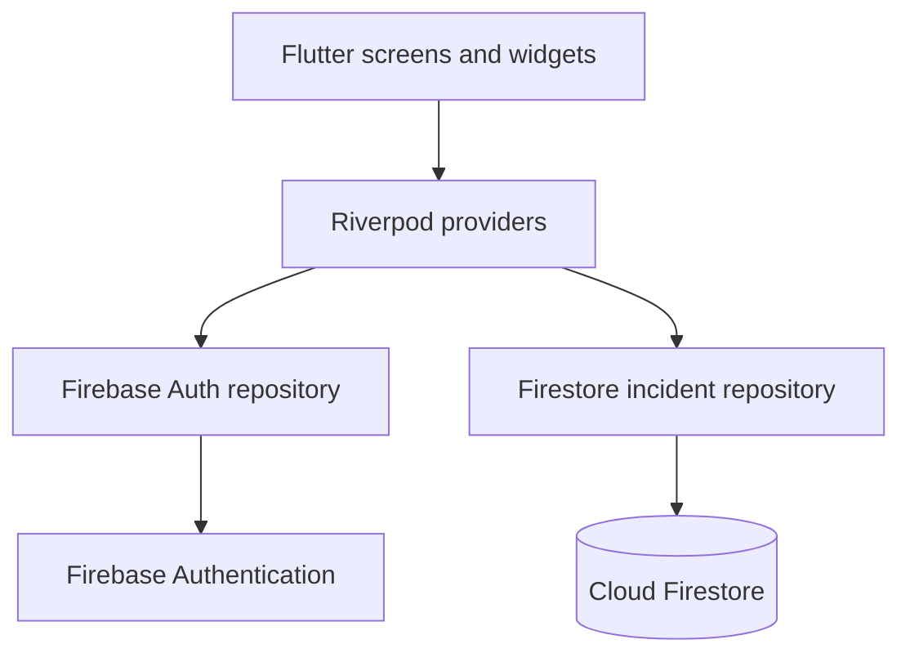

# ReportIt

ReportIt is a Flutter mobile application for reporting and tracking campus
incidents. Students can submit issues such as broken facilities, water
shortages, electricity outages, damaged furniture, sanitation problems, and
safety concerns. Authorized staff can review reports and update their status.

## Features

- ALU student email authentication with email verification
- Firestore-backed incident creation and persistence
- Incident categories, descriptions, and campus locations
- Student report history with search and filters
- Report detail pages
- Staff dashboard for reviewing all reports
- Staff-only status updates:
  - Submitted
  - In progress
  - Resolved
- Riverpod state management
- Loading, validation, and error feedback

## Architecture

The project uses a feature-first structure with separate presentation,
application, and data responsibilities.



### Main directories

```text
lib/
  features/
    auth/
      application/   Authentication and role providers
      data/          Firebase Auth repository
      presentation/  Auth gate, sign-in, and verification screens
    home/
      presentation/  Student report history and filters
    reports/
      application/   Incident providers
      data/          Incident model and Firestore repository
      presentation/  Report creation and details
    staff/
      presentation/  Staff report queue and status controls
  theme/             Shared colors and Material theme
```

## Firebase data structure

### `incidents/{incidentId}`

| Field | Type | Description |
|---|---|---|
| `title` | string | Short report title |
| `description` | string | Detailed explanation of the issue |
| `category` | string | Incident category |
| `location` | string | Campus location |
| `reportedBy` | string | Firebase Authentication user UID |
| `reportedAt` | timestamp | Creation time |
| `updatedAt` | timestamp | Last status update time |
| `status` | string | `submitted`, `inProgress`, or `resolved` |

### `users/{userId}`

Staff accounts receive this document field:

```text
role: staff
```

Firestore rules allow students to read their own reports. Staff can read all
reports and update only `status` and `updatedAt`. Reports cannot be deleted
through the application.

## Authentication and access control

1. A user registers with an `@alustudent.com` email address.
2. Firebase Authentication sends a verification email.
3. The app blocks access until the email is verified.
4. The app checks `users/{uid}.role`.
5. Users with `role: staff` see the staff dashboard; other verified users see
   the student dashboard.
6. Firestore rules enforce the same access boundaries server-side.

To create a staff account for testing:

1. Register the account through the app.
2. Copy its UID from Firebase Console → Authentication → Users.
3. Create `users/{uid}` in Firestore.
4. Add `role` with the value `staff`.

## Testing and validation

Run the following commands from the project directory:

```powershell
flutter analyze
flutter test
flutter build apk --debug
```

The automated tests currently cover:

- ALU email-domain validation
- Human-readable incident status labels

Manual demonstration scenarios should cover:

1. Student registration and email verification
2. Student sign-in and sign-out
3. Creating an incident
4. Viewing report history and details
5. Searching and filtering reports
6. Staff sign-in
7. Staff status updates
8. Student visibility of updated status

## Temporary limitation

Photo uploads are temporarily disabled because Firebase Cloud Storage requires
a billing-enabled Firebase plan. The current implementation completes the
incident workflow without photographs while development continues. Firebase
Storage can be restored after an approved billing arrangement or an
instructor-approved alternative is available.

This limitation should be disclosed in the technical report and demonstration
video rather than presented as a completed photo-upload feature.

## Lessons learned

- Firebase client configuration and Firebase Console services must be enabled
  together; a valid Android configuration alone does not enable Authentication
  or Firestore access.
- Firestore compound queries may require explicitly deployed composite indexes.
- Client-side role routing improves the user experience, but Firestore rules
  are required to enforce authorization securely.
- Riverpod keeps authentication and incident streams separate from screen
  widgets, making refresh and error states easier to manage.

## Project status

The project is being developed incrementally. Firebase configuration files are
generated for the `reportit-91b8e` project, and Firestore rules and indexes are
tracked in:

- `firebase.json`
- `firestore.rules`
- `firestore.indexes.json`
